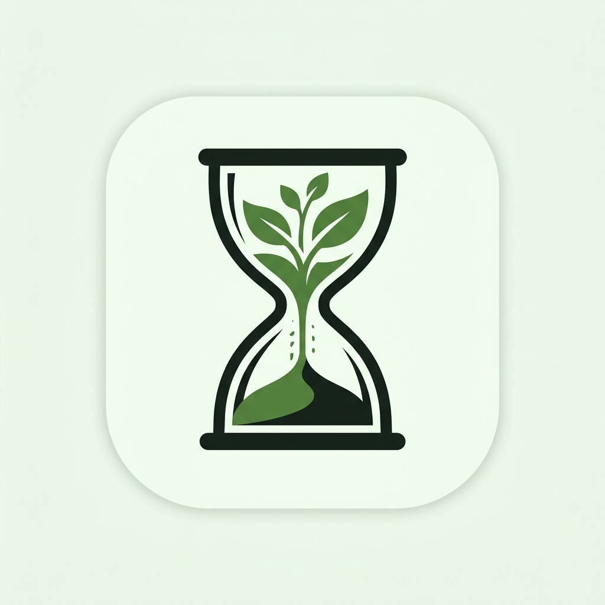
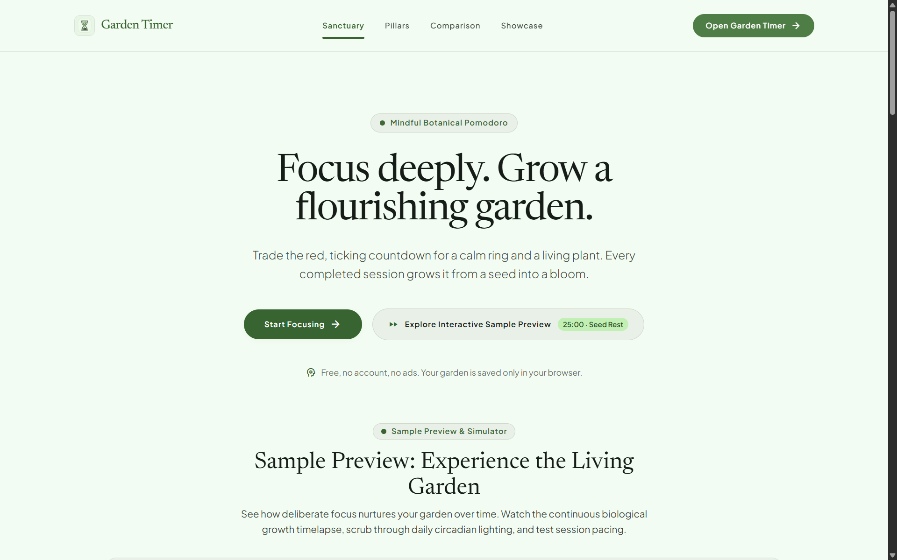
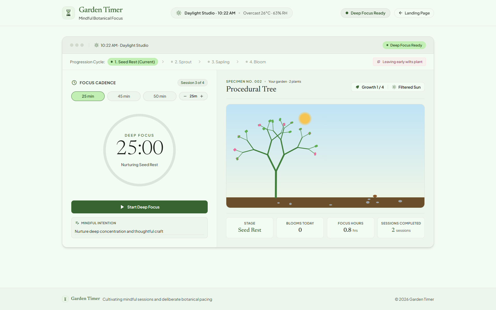
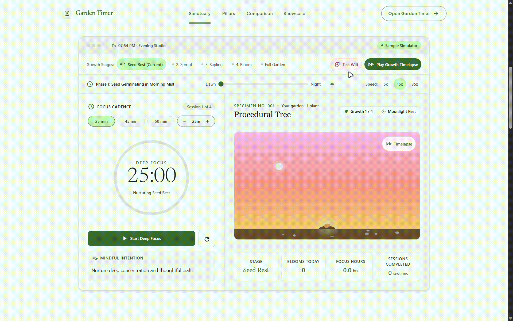
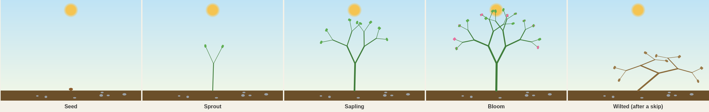
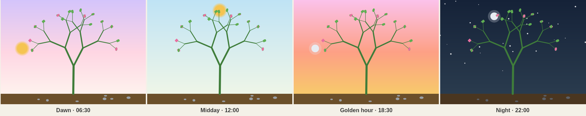

<div style="text-align: center;">



# Garden Timer

[](https://github.com/Spike271/Garden-Timer/actions/workflows/deploy.yml)

<p style="text-align: center;"><em>A Pomodoro timer where your plant is the progress bar.</em></p>

</div>

---

## About the Project

Garden Timer turns the Pomodoro technique into a small botanical ritual. Finish a focus session and your plant grows a stage, from seed to sprout to sapling to bloom. Forfeit one and it wilts. The sky behind the plant follows your local clock, with a sun by day, a moon and stars at night, and dawn and golden-hour light in between. The goal is a garden full of blooms, with no streak pressure and no alarms.

## Screenshots











## Features

- **Pomodoro cycle** — focus, short break, focus, … with a long break after every 4th completed focus session.
- **Editable lengths** — focus presets of 25, 45 and 50 minutes, plus a ±5 minute stepper (5–180 min), hold to repeat. Short break (1–60 min) and long break (1–120 min) have ±1 minute steppers. Saved locally and applied from the next session.
- **Forfeit needs a second tap.** Abandoning a focus session takes two taps within 4 seconds (Escape cancels), so a stray tap can't wilt your plant. Break lengths and presets are locked while a session runs and apply to the next one.
- **Survives reloads** — a running session is restored after a refresh or closed tab, with the correct time left.
- **Procedural plant** — a recursive branch renderer draws four growth stages with a gentle idle sway. No sprite art.
- **Wilt and recovery** — a forfeited focus session drops the plant one stage and wilts it. The next completed session heals it.
- **A garden, not one plant** — after a healthy bloom, the next completed session plants a new seed beside it. Every plant stays on screen.
- **Real-time sky** — sun, moon, stars and four sky bands driven by your local time, moving smoothly along an arc.
- **Live weather** in the header (see [Network and privacy](#network-and-privacy)).
- **Drift-proof timer** — it stores an absolute end time, so throttled background tabs can't skew the countdown.
- **Landing page** with an interactive timelapse that runs a tree through a day.
- **Honest stats** — sessions completed, blooms grown today, and focus hours. All start at zero. Focus hours are banked from the real length of each completed session, so changing the length later never rewrites history.
- **Local-only** — no accounts and no backend. Your garden lives in `localStorage`.

## Technologies Used

- **Language:** JavaScript (ES modules, JSX)
- **UI:** React 18 and the HTML5 Canvas 2D API
- **Build:** Vite 8 with `@vitejs/plugin-react`
- **Styling:** Tailwind CSS 3, compiled at build time through PostCSS, plus Google Fonts (Newsreader, Plus Jakarta Sans, Material Symbols)
- **Tooling:** Oxlint and Oxfmt
- **Hosting:** GitHub Pages, deployed by GitHub Actions

## How to Use

1. Open the [landing page](https://spike271.github.io/Garden-Timer/) and press a call-to-action button to enter the app.
2. Pick a focus length with a preset or the stepper.
3. Press **Start**. The ring fills as the session runs.
4. Stay until the ring completes. Your plant grows one stage.
5. A break starts next. Start it, or skip it.
6. After the fourth completed focus session, the break is long.

> A running timer is not saved. Refreshing or closing the tab mid-session loses it, but it does not wilt the plant. Only an explicit forfeit does.

## Controls

| Control                  | What it does                                                             |
| ------------------------ | ------------------------------------------------------------------------ |
| **Start**                | Starts the current phase using the saved durations.                      |
| **Forfeit Cycle (Wilt)** | During focus: abandons the session. The plant drops one stage and wilts. |
| **Skip Break**           | During a break: ends it and returns to focus. No effect on the plant.    |
| **25 / 45 / 50 presets** | Sets the next focus length.                                              |
| **− / + stepper**        | Changes the focus length by 5 minutes, clamped to 5–180. Hold to repeat. |
| **Intention field**      | A free-text note for the session. Kept in memory only.                   |
| **Back link (header)**   | Returns to the landing page.                                             |

## Game Mechanics

### What happens to the plant

| Event                                                              | Active plant                                                              |
| ------------------------------------------------------------------ | ------------------------------------------------------------------------- |
| Focus session completes                                            | Grows one stage and clears any wilt.                                      |
| Focus session completes while the plant is already a healthy bloom | A new seed is planted and becomes the active plant.                       |
| Focus session completes on a wilted plant                          | Wilt clears and the plant grows one stage. A wilted bloom heals in place. |
| Focus session forfeited                                            | Drops one stage (never below seed) and wilts.                             |
| Break completes or is skipped                                      | No change.                                                                |

Stages in order: **seed → sprout → sapling → bloom**.

### Timer phases

| Phase       | Default length                                  | Editable in the UI |
| ----------- | ----------------------------------------------- | ------------------ |
| Focus       | 25 min                                          | Yes (5–180 min)    |
| Short break | 5 min                                           | Yes (1–15 min)     |
| Long break  | 15 min, after every 4th completed focus session | Yes (15–60 min)    |

Forfeited sessions do not count toward the long-break cycle.

### Sky by local time

| Local time    | Sky                                 |
| ------------- | ----------------------------------- |
| 05:00 – 08:00 | Dawn: lilac to pink to cream        |
| 08:00 – 17:00 | Day: pale blue to soft green        |
| 17:00 – 20:00 | Golden hour: pink to orange to gold |
| 20:00 – 05:00 | Night: navy sky, stars, darker soil |

The **sun** is shown from 06:00 to 18:00, rising on the left, peaking at noon and setting on the right. The **moon** takes the same arc from 18:00 to 06:00.

### What is saved

| `localStorage` key      | Contents                                                                 |
| ----------------------- | ------------------------------------------------------------------------ |
| `garden-timer:garden`   | Every plant: stage, wilt state, and the day it last reached full bloom.  |
| `garden-timer:presets`  | Focus and break lengths.                                                 |
| `garden-timer:timer`    | Timer state: phase, absolute end time, sessions done, banked focus time. |
| `garden-timer:workDone` | Legacy session count, migrated automatically (focus hours estimated).    |
| `garden-timer:weather`  | Cached weather reading (about 25 minutes).                               |
| `garden-timer:plant`    | Legacy single-plant save, migrated automatically on first load.          |

## Network and privacy

There is no backend, analytics or account system. Two things do leave your browser:

- **Weather.** The header reading uses the IP-based location from [GeoJS](https://get.geojs.io) to get approximate coordinates. If that fails, the browser asks for location permission instead. The coordinates are then sent to [Open-Meteo](https://open-meteo.com) for temperature, humidity and conditions. The result is cached locally.
- **Third-party assets.** Google Fonts and the three gallery illustrations load from their own servers on page load. No third-party scripts run in your browser.

## Reload behavior

The running timer is saved on start, skip and completion. On reload:

- **Still running:** it resumes with the correct time left.
- **Ended while you were away, by less than one session length:** it completes normally and the plant grows.
- **Ended while you were away, by more than one session length:** it is treated as abandoned. No growth, no wilt, and the timer returns to an idle focus phase. Closing the tab for days is not a free bloom.
- **Upgrading from an older save:** the old session count is kept. Focus hours for those sessions are estimated using your current focus length, one time only. Everything after that is exact.

## Known limitations

- **Blooms Today** counts healthy blooms that reached full bloom on today's local date. Plants saved before bloom dates existed are never counted as today's.
- Two tabs open at once share one `localStorage` save and the last write wins. Use one tab.
- Changing a length applies from the next session. A running session keeps its original length.

## Accessibility

- Keyboard: every control is reachable, with a visible 2px focus ring and a skip link. Escape dismisses the toast.
- Screen readers: the countdown is a `timer`, phase and length changes are announced politely (not per tick), the selected preset uses `aria-pressed`, and the garden canvas has a state-based description.
- Targets are at least 44px, text is at least 12px, and all text meets 4.5:1 contrast.
- Steppers support hold-to-repeat and typing a value directly.

## Prerequisites

- **Node.js** `^20.19.0` or `>=22.12.0` (required by Vite 8)
- **npm**, which ships with Node
- A modern browser with Canvas 2D support

## Building the Project

### Run locally

1. Clone and install:
   ```bash
   git clone https://github.com/Spike271/Garden-Timer.git
   cd Garden-Timer
   npm install
   ```
2. Start the dev server:
   ```bash
   npm run dev
   ```
3. Open `http://localhost:5173/` for the landing page and `http://localhost:5173/app` for the app.

> `/app` and `/garden-timer` are dev-server rewrites to `app.html`. On a static host, use `app.html` directly.

### Production build

1. Build and preview:
   ```bash
   npm run build
   npm run preview
   ```
2. Output goes to `dist/`.

### Scripts

| Script                 | Description                                                     |
| ---------------------- | --------------------------------------------------------------- |
| `npm run dev`          | Dev server with HMR.                                            |
| `npm run build`        | Production build of both pages.                                 |
| `npm run preview`      | Serves the production build locally.                            |
| `npm test`             | Runs the Vitest suite (reducer, storage, settings, components). |
| `npm run lint`         | Runs Oxlint.                                                    |
| `npm run format`       | Formats the code with Oxfmt.                                    |
| `npm run format:check` | Checks formatting without changing files.                       |

## Acknowledgements

- [React](https://react.dev) and [Vite](https://vite.dev)
- [Open-Meteo](https://open-meteo.com) for weather data and [GeoJS](https://get.geojs.io) for IP geolocation
- [Tailwind CSS](https://tailwindcss.com), and [Google Fonts](https://fonts.google.com) for Newsreader, Plus Jakarta Sans and Material Symbols
- [Oxc](https://oxc.rs) for Oxlint and Oxfmt
